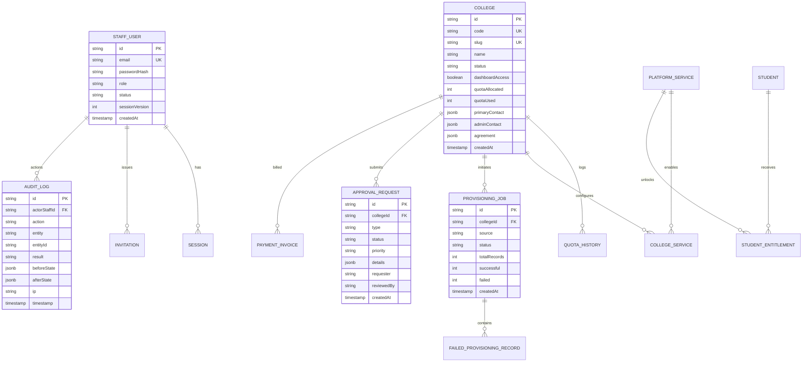

# BEXO Admin Panel — System Architecture & Integration Blueprint

## 1. Architectural Vision & System Boundaries

The **BEXO Admin Panel Backend** (`bexo-admin-backend`) serves as the central corporate command-and-control service for the entire BEXO institutional ecosystem. It is architecturally decoupled from individual institutional installations and mobile consumer runtimes while providing the single authoritative source of truth for:

- **Corporate Administration & RBAC**: Central staff accounts, roles, access policies, and cryptographic invitations.
- **Institutional Governance**: College registry, lifecycle states (`Active`, `Pending`, `Suspended`), contract agreements (MOUs), and departmental seat quotas.
- **Service Entitlements**: Catalog of global platform capabilities (`BEXO Portfolio`, `BEXO Templates`, `ATS Resume Engine`) and their per-institution toggle states.
- **Provisioning Engine**: Asynchronous roster ingest and entitlement allocation tracking across colleges.
- **Approval & Decision Ledger**: Two-phase operational requests (quota expansion, new institution registration, service activations).
- **Payment & Invoice Telemetry**: Institutional subscription and invoice tracking.
- **Security & Audit Telemetry**: Append-only, tamper-resistant administrative audit trail.
- **App Templates Catalog**: Central marketplace for mobile and web portfolio/resume templates.

```mermaid
flowchart TB
    subgraph Frontend Tier
        AdminUI["Admin Panel Frontend\n(React + Vite :5173)"]
        CollegeUI["College Panel Frontend\n(React + Vite :5174)"]
        MobileApp["BEXO Mobile App\n(React Native / Expo)"]
    end

    subgraph Corporate Backend Boundary ["admin-panel/backend/ (:8080)"]
        AuthMod["Auth & Sessions\n(JWT + Revocation)"]
        CollegeMod["College & Quotas\n(Lifecycle State)"]
        ProvMod["Provisioning Engine\n(Batch & Entitlements)"]
        ApprMod["Approval Ledger\n(Two-Phase Review)"]
        AuditMod["Audit Ledger\n(Append-Only)"]
        TemplMod["Template Catalog\n(Publish & Tiers)"]
        IntegAdapter["Integration Adapters\n(College & Mobile)"]
    end

    subgraph College Backend Boundary ["college-panel/backend/ (:8000)"]
        ClgAPI["College Tenant API\n(Rosters & Verification)"]
        ClgDB[("College Local DB")]
    end

    subgraph Mobile Backend Boundary ["Bexo_mobile_App-main/Backend/ (:5000)"]
        MobAPI["Mobile API Gateway\n(Profiles & Portfolios)"]
        MobDB[("Mobile Consumer DB")]
    end

    AdminUI -->|REST /api/v1| Corporate Backend Boundary
    IntegAdapter -.->|Service-to-Service Signed MTLS/JWT| ClgAPI
    IntegAdapter -.->|Service-to-Service Signed MTLS/JWT| MobAPI
```

---

## 2. Database Ownership & Entity Relationships

### 2.1 Database Separation & Tenancy Model
To avoid multi-master synchronization hazards and schema tight-coupling:
1. **Admin Backend Database**: Owns corporate accounts, master college directory records, global service catalog, quota history, approval workflow requests, platform templates, and immutable administrative audit logs.
2. **College Panel Database**: Owns college-specific student rosters, local staff members, local notifications, and departmental assignment.
3. **Mobile App Database**: Owns consumer profiles, mobile OTP auth state, resume drafts, portfolio project assets, and retail subscription mandates.

### 2.2 Entity Relationship Model



---

## 3. Authentication & Authorization Model

### 3.1 Corporate Strict RBAC
The corporate portal enforces five administrative roles:
1. `super_admin`: Full system authority across all institutions, financial records, template management, staff provisioning, and audit logs.
2. `admin` / `platform_admin`: Day-to-day corporate operations, college onboarding, staff invitations, and quota management.
3. `ops`: Operational request review, bulk provisioning execution, and college profile updates.
4. `finance`: Payment tracking, agreement term audits, and invoice ledger updates.
5. `support`: Read-only oversight across colleges and students, password reset link distribution assistance, and notification monitoring.

### 3.2 Multi-Tenant Perimeter Guard
The Admin Panel authenticates **only central corporate identities**.
Any user account bearing a `collegeId` attribute or a role starting with `college_` (e.g., `college_admin`, `college_staff`, `college_coordinator`) is rejected at the `/api/v1/auth/login` gateway with HTTP `403 Forbidden`:
```json
{
  "success": false,
  "statusCode": 403,
  "message": "Institutional Access Restricted: This portal is for central BEXO corporate administrators. College staff must access via the dedicated College Portal."
}
```

### 3.3 Session Management & Cryptographic Tokens
- **Access Tokens**: Short-lived (e.g., 15 minutes to 24 hours), signed with HMAC-SHA256 or RS256, carrying `userId`, `email`, `role`, and `sessionVersion`.
- **Session Version Bumping**: Instant revocation on security events (logout, password change, account suspension) by incrementing `sessionVersion` in the database.
- **Invitation & Reset Tokens**: Cryptographically random 32-byte hex strings. The raw token is dispatched via email; only its SHA-256 hash is persisted in the database with strict single-use semantics and 7-day (or 1-hour) expiration.

---

## 4. API Endpoint Mapping to Frontend Features

All routes are mounted under `/api/v1` and comply strictly with `API_CONTRACT.md`:

| Route Prefix | Frontend Feature Component | Operations Supported |
| :--- | :--- | :--- |
| `/auth` | `Login.tsx`, `ResetPassword.tsx`, `ActivateAccount.tsx` | Login, Logout, Profile (`/me`), Forgot Password, Reset Token Validation, Password Reset, Invitation Token Validation, Account Activation |
| `/colleges` | `Colleges.tsx`, `CollegeDetails.tsx`, `NewCollegeModal.tsx` | Directory list, College Profile, Registration, Profile Edit, Suspension, Reactivation, Quota Adjustment, Quota Audit History, Service Assignment Toggle |
| `/students` | `Students.tsx`, `StudentDetailsModal.tsx` | Student roster query, Profile inspect, Add student, Revoke access, Reactivate access |
| `/users` | `Users.tsx`, `InviteStaffModal.tsx` | Corporate staff directory, Add staff, Update role/profile, Revoke staff |
| `/invitations` | `Users.tsx`, `InviteStaffModal.tsx` | Issue cryptographic invitation, Resend invitation, Revoke invitation |
| `/approvals` | `Approvals.tsx`, `ApprovalReviewModal.tsx` | Requests list, Approve operational request, Reject operational request, Submit corporate request |
| `/provisioning` | `Provisioning.tsx`, `BulkProvisionModal.tsx` | Batch jobs list, Job inspection with failed records, Trigger roll range / CSV batch |
| `/services` | `Services.tsx` | Platform services catalog, Global enable/disable toggle |
| `/payments` | `Payments.tsx`, `RecordPaymentModal.tsx` | Invoice & transaction ledger, Record payment invoice |
| `/notifications`| `Notifications.tsx`, Header Dropdown | Notifications list, Mark single read, Mark all read, Dismiss notification |
| `/audit` | `Audit.tsx` | Administrative tamper-resistant audit ledger query, Record audit entry |
| `/templates` | `Templates.tsx`, `CreateTemplateModal.tsx` | App templates catalog, Create, Update, Delete, Toggle Publish, Toggle Featured |
| `/system` | `SystemHealth.tsx`, Header indicator | Cluster telemetry, Redis/DB/Service latency metrics |
| `/health` | Cloud Probes & Load Balancers | Lightweight liveness probe |

---

## 5. College Panel Integration Boundary

The College Panel backend (`college-panel/backend`) operates within an individual college's tenant boundary. When central corporate actions occur, the Admin Backend interacts with the College Panel through:

1. **Authoritative Lifecycle Push**: When an institution is suspended via `POST /api/v1/colleges/:id/suspend`, the Admin Backend notifies the College Panel via an idempotent internal webhook:
   - Sets `dashboardAccess: false` on the college tenant.
   - Preserves all student portfolios, resumes, and academic records intact.
2. **Quota Allocation Synchronization**: Central corporate approvals for quota increases atomically update the master `quotaAllocated` and push the updated quota threshold to the College Panel.
3. **Decoupled Architecture**: If the College Panel is offline or unreachable, the Admin Backend queues synchronization events with exponential backoff and jitter, ensuring corporate operations never fail due to downstream institutional outages.

---

## 6. BEXO Mobile App Integration Boundary

The BEXO Mobile Backend (`Bexo_mobile_App-main/Backend`) owns direct student/consumer authentication, OTP verification, and portfolio rendering.

1. **Student Identity Mapping**: When an institution bulk-provisions students, the Admin Backend creates an institutional student record and entitlement (`stu-xxx`). When the student signs into the mobile app using their verified college email or phone, the mobile backend verifies institutional entitlement eligibility against the Admin Backend or shared entitlement registry.
2. **Suspension & Graceful Downgrade**: If a college is suspended or a student's access is revoked by corporate admin:
   - The student's institutional premium entitlement is marked `Suspended` or `Revoked`.
   - The student's public portfolio remains live (or gracefully transitions to free tier) without data destruction.
3. **Template Registry**: Templates curated in the Admin Panel (`/api/v1/templates`) are exposed as a read-only catalog to the mobile app for student portfolio themes.

---

## 7. Migration and Deployment Strategy

1. **PostgreSQL Schema Versioning**: Powered by Drizzle ORM and Drizzle Kit. Migrations are generated into versioned SQL files (`src/db/migrations/*.sql`) and applied sequentially via `src/db/migrate.ts`.
2. **Zero-Downtime Safe Migrations**: Schema alterations must use backward-compatible additive changes (e.g., adding nullable columns or default values before backfilling).
3. **Non-Destructive Database Policy**: `db:drop` or destructive schema resets are prohibited in staging and production environments.
4. **Environment Isolation**:
   - `development`: Safe local testing with seeded development fixtures.
   - `test`: In-memory repository or isolated test database running unit and integration suites.
   - `staging`: Strict TLS database connection with staging credentials.
   - `production`: Fully managed PostgreSQL with TLS certificate verification, connection pooling, and read-replica support.

---

## 8. Security Assumptions & Operational Hardening

1. **Zero Secret Leakage**: Database URLs, JWT secrets, and SMTP credentials must never appear in log output, client error payloads, or Git commits.
2. **Brute-Force & Enumeration Mitigation**:
   - Rate limiting on `/auth/login`, `/auth/forgot-password`, and `/auth/activate-account`.
   - Password reset endpoints return generic success messages whether an account exists or not.
3. **SQL Injection & XSS Prevention**:
   - Fully parameterized queries using Drizzle ORM.
   - Strict Zod schema parsing on all input bodies, query parameters, and route parameters.
   - Helmet HTTP security headers (CSP, HSTS, X-Content-Type-Options, Frameguard).
4. **CORS Allowlist**: Explicitly restricted to configured origins (e.g., `http://localhost:5173` for frontend, corporate domain in production).
